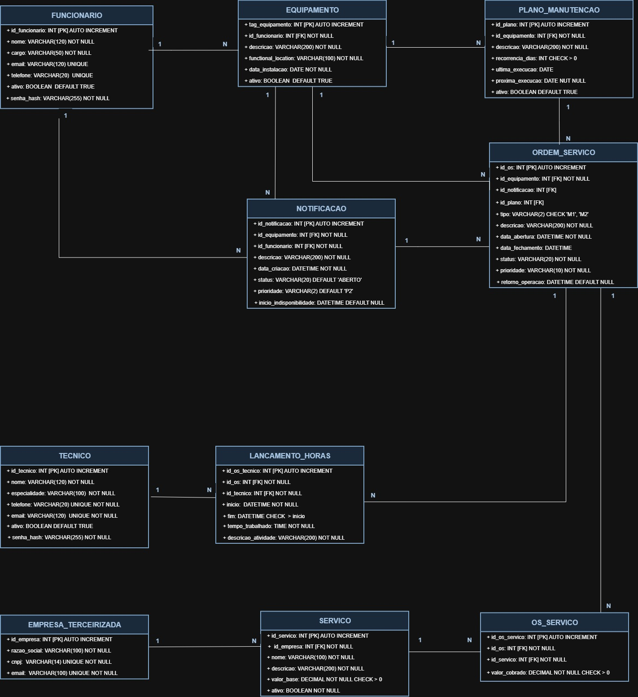

# Sistema de Gestão de Manutenção Industrial

## 1. Capa e identificação

| Identificação | Informação |
|---|---|
| Instituição | Centro Universitário Afya |
| Curso | Engenharia de Computação |
| Disciplina | Modelagem Relacional de Banco de Dados |
| Integrantes | Luiz Gustavo Oliveira Santos e Gabriel Soares Fonseca |
| Semestre letivo | 6° Período |
| Local | Montes Claros – MG |
| Tema | Sistema de Gestão de Manutenção Industrial |

## 2. Resumo executivo

O projeto propõe um banco de dados relacional para gestão da manutenção industrial, inspirado no módulo SAP PM. O sistema centraliza o cadastro de ativos, funcionários, técnicos, notificações de falha, planos preventivos, ordens de serviço corretivas (M1) e preventivas (M2), apontamentos de mão de obra e contratação de serviços externos.

A solução utiliza MySQL e dez tabelas, com integridade referencial e consultas destinadas a operadores, planejadores de manutenção (PCM), supervisores, gestores e engenharia de confiabilidade. Os registros de início de indisponibilidade e retorno à operação, associados aos lançamentos de horas, permitem analisar MTBF, MTTR, indisponibilidade e custos terceirizados, respeitando as premissas de medição descritas neste relatório.

## 3. Domínio e regras de negócio

Em uma planta industrial, funcionários registram equipamentos identificados por TAG e localização funcional e comunicam anomalias por notificações. O PCM analisa essas notificações e gera ordens corretivas, enquanto planos periódicos originam ordens preventivas. Técnicos registram os períodos e descrições das intervenções; serviços especializados podem ser contratados de empresas externas. O gestor acompanha a demanda, os recursos e a confiabilidade dos ativos.

- Cada equipamento é cadastrado por um funcionário; cada notificação pertence a um equipamento e tem um funcionário responsável pelo registro.
- Uma OS M1 provém de uma notificação; uma OS M2 provém de um plano. As origens são mutuamente exclusivas. O equipamento da OS deve coincidir com o da origem (regra de aplicação, não garantida pelas FKs isoladas).
- Um plano pertence a um equipamento e possui recorrência positiva em dias, última execução opcional e próxima execução prevista.
- Notificações usam ABERTO, EM_ANALISE e FECHADA; ordens usam PLANEJADA, EM_EXECUCAO e CONCLUIDA. P1 representa prioridade alta e P2 prioridade normal.
- A indisponibilidade é opcional: nem toda notificação implica parada. O retorno à operação pode preceder o encerramento administrativo da OS.
- Uma OS pode envolver vários técnicos e um técnico pode atuar em várias OS, inclusive com lançamentos repetidos na mesma ordem. O tempo trabalhado corresponde à diferença entre fim e início.
- Cada serviço pertence a uma empresa terceirizada; uma OS pode contratar vários serviços e um serviço pode ser contratado em diferentes OS. O valor cobrado preserva o preço efetivamente contratado.
- Exclusões de registros referenciados são restringidas e alterações de chaves propagadas por ON UPDATE CASCADE. Cadastros podem ser desativados para preservar histórico.
- Para os indicadores demonstrativos, cada falha tem uma OS corretiva representativa, com retorno registrado quando restaurada. Não se deve duplicar eventos de falha. O MTBF assume operação contínua nos intervalos analisados, sem outras paradas; o MTTR usa o intervalo do primeiro início ao último fim dos apontamentos de reparo. Pausas internas podem estar incluídas; horas-pessoa não equivalem à duração do reparo.

### 3.1 Relacionamentos

| Origem (1) | Destino (N) |
|---|---|
| FUNCIONARIO | EQUIPAMENTO |
| FUNCIONARIO | NOTIFICACAO |
| EQUIPAMENTO | NOTIFICACAO |
| EQUIPAMENTO | PLANO_MANUTENCAO |
| EQUIPAMENTO | ORDEM_SERVICO |
| NOTIFICACAO | ORDEM_SERVICO (origem opcional) |
| PLANO_MANUTENCAO | ORDEM_SERVICO (origem opcional) |
| ORDEM_SERVICO | LANCAMENTO_HORAS |
| TECNICO | LANCAMENTO_HORAS |
| EMPRESA_TERCEIRIZADA | SERVICO |
| ORDEM_SERVICO | OS_SERVICO |
| SERVICO | OS_SERVICO |

As duas relações N:N são ORDEM_SERVICO × TECNICO (LANCAMENTO_HORAS) e ORDEM_SERVICO × SERVICO (OS_SERVICO). São dez tabelas e doze vínculos 1:N.

## 4. Diagrama de classes / DER



**Figura 1 —** Modelo final fornecido pela dupla. PK indica chave primária; FK indica chave estrangeira; 1 e N indicam cardinalidades. Os campos `inicio_indisponibilidade` e `retorno_operacao` viabilizam a análise de eventos de falha. O DDL acrescenta restrições de integridade e explicita algumas nulabilidades que não aparecem no desenho; o dicionário abaixo documenta o esquema físico.

## 5. Dicionário de dados

Tipos e restrições conforme o arquivo SQL de criação. Para todas as FKs: ON DELETE RESTRICT e ON UPDATE CASCADE. BOOLEAN é representado pelo MySQL como TINYINT(1). Valores monetários em reais, com duas casas decimais.

### 5.1 FUNCIONARIO

| Atributo | Tipo | Restrições | Descrição |
|---|---|---|---|
| `id_funcionario` | `INT` | AUTO_INCREMENT PRIMARY KEY | Identificador único do registro |
| `nome` | `VARCHAR(120)` | NOT NULL | Nome da pessoa ou do serviço |
| `cargo` | `VARCHAR(50)` | NOT NULL | Função profissional |
| `email` | `VARCHAR(120)` | NOT NULL UNIQUE | Endereço eletrônico de contato |
| `telefone` | `VARCHAR(20)` | UNIQUE | Telefone de contato |
| `ativo` | `BOOLEAN` | NOT NULL DEFAULT TRUE | Indica cadastro ativo |
| `senha_hash` | `VARCHAR(255)` | NOT NULL | Hash da senha, não a senha em texto puro |

### 5.2 TECNICO

| Atributo | Tipo | Restrições | Descrição |
|---|---|---|---|
| `id_tecnico` | `INT` | AUTO_INCREMENT PRIMARY KEY | Identificador único do registro |
| `nome` | `VARCHAR(120)` | NOT NULL | Nome da pessoa ou do serviço |
| `especialidade` | `VARCHAR(100)` | NOT NULL | Área técnica de atuação |
| `telefone` | `VARCHAR(20)` | NOT NULL UNIQUE | Telefone de contato |
| `email` | `VARCHAR(120)` | NOT NULL UNIQUE | Endereço eletrônico de contato |
| `ativo` | `BOOLEAN` | NOT NULL DEFAULT TRUE | Indica cadastro ativo |
| `senha_hash` | `VARCHAR(255)` | NOT NULL | Hash da senha, não a senha em texto puro |

### 5.3 EMPRESA_TERCEIRIZADA

| Atributo | Tipo | Restrições | Descrição |
|---|---|---|---|
| `id_empresa` | `INT` | AUTO_INCREMENT PRIMARY KEY | Identificador único do registro |
| `razao_social` | `VARCHAR(100)` | NOT NULL | Nome empresarial |
| `cnpj` | `VARCHAR(14)` | NOT NULL UNIQUE | Identificador cadastral de 14 caracteres |
| `email` | `VARCHAR(100)` | NOT NULL UNIQUE | Endereço eletrônico de contato |

### 5.4 EQUIPAMENTO

| Atributo | Tipo | Restrições | Descrição |
|---|---|---|---|
| `tag_equipamento` | `INT` | AUTO_INCREMENT PRIMARY KEY | Identificador único do registro |
| `id_funcionario` | `INT` | NOT NULL; FK → FUNCIONARIO(id_funcionario) | Referência a FUNCIONARIO(id_funcionario) |
| `descricao` | `VARCHAR(200)` | NOT NULL | Descrição do registro |
| `functional_location` | `VARCHAR(100)` | NOT NULL | Localização funcional na planta |
| `data_instalacao` | `DATE` | NOT NULL | Data de instalação do ativo |
| `ativo` | `BOOLEAN` | NOT NULL DEFAULT TRUE | Indica cadastro ativo |

### 5.5 PLANO_MANUTENCAO

| Atributo | Tipo | Restrições | Descrição |
|---|---|---|---|
| `id_plano` | `INT` | AUTO_INCREMENT PRIMARY KEY | Identificador único do registro |
| `id_equipamento` | `INT` | NOT NULL; FK → EQUIPAMENTO(tag_equipamento) | Referência a EQUIPAMENTO(tag_equipamento) |
| `descricao` | `VARCHAR(200)` | NOT NULL | Descrição do registro |
| `recorrencia_dias` | `INT` | NOT NULL | Periodicidade da manutenção em dias |
| `ultima_execucao` | `DATE` | NULL | Data da última execução preventiva |
| `proxima_execucao` | `DATE` | NOT NULL | Data prevista da próxima execução |
| `ativo` | `BOOLEAN` | NOT NULL DEFAULT TRUE | Indica cadastro ativo |

**CHECK:** `recorrencia_dias > 0)`.

### 5.6 NOTIFICACAO

| Atributo | Tipo | Restrições | Descrição |
|---|---|---|---|
| `id_notificacao` | `INT` | AUTO_INCREMENT PRIMARY KEY | Identificador único do registro |
| `id_equipamento` | `INT` | NOT NULL; FK → EQUIPAMENTO(tag_equipamento) | Referência a EQUIPAMENTO(tag_equipamento) |
| `id_funcionario` | `INT` | NOT NULL; FK → FUNCIONARIO(id_funcionario) | Referência a FUNCIONARIO(id_funcionario) |
| `descricao` | `VARCHAR(200)` | NOT NULL | Descrição do registro |
| `data_criacao` | `DATETIME` | NOT NULL DEFAULT CURRENT_TIMESTAMP | Momento do registro da notificação |
| `status` | `VARCHAR(20)` | NOT NULL DEFAULT 'ABERTO' | Situação do registro |
| `prioridade` | `VARCHAR(2)` | NOT NULL DEFAULT 'P2' | Classificação de urgência |
| `inicio_indisponibilidade` | `DATETIME` | NULL | Momento em que o ativo ficou indisponível |

**CHECK:** `inicio_indisponibilidade IS NULL OR inicio_indisponibilidade <= data_criacao)`; `prioridade IN ('P1', 'P2'))`; `status IN ('ABERTO','EM_ANALISE','FECHADA'))`.

### 5.7 SERVICO

| Atributo | Tipo | Restrições | Descrição |
|---|---|---|---|
| `id_servico` | `INT` | AUTO_INCREMENT PRIMARY KEY | Identificador único do registro |
| `id_empresa` | `INT` | NOT NULL; FK → EMPRESA_TERCEIRIZADA(id_empresa) | Referência a EMPRESA_TERCEIRIZADA(id_empresa) |
| `nome` | `VARCHAR(100)` | NOT NULL | Nome da pessoa ou do serviço |
| `descricao` | `VARCHAR(200)` | NOT NULL | Descrição do registro |
| `valor_base` | `DECIMAL(10,2)` | NOT NULL | Preço de referência do serviço |
| `ativo` | `BOOLEAN` | NOT NULL DEFAULT TRUE | Indica cadastro ativo |

**CHECK:** `valor_base > 0)`.

### 5.8 ORDEM_SERVICO

| Atributo | Tipo | Restrições | Descrição |
|---|---|---|---|
| `id_os` | `INT` | AUTO_INCREMENT PRIMARY KEY | Identificador único do registro |
| `id_equipamento` | `INT` | NOT NULL; FK → EQUIPAMENTO(tag_equipamento) | Referência a EQUIPAMENTO(tag_equipamento) |
| `id_notificacao` | `INT` | NULL; FK → NOTIFICACAO(id_notificacao) | Referência a NOTIFICACAO(id_notificacao) |
| `id_plano` | `INT` | NULL; FK → PLANO_MANUTENCAO(id_plano) | Referência a PLANO_MANUTENCAO(id_plano) |
| `tipo` | `VARCHAR(2)` | NOT NULL | M1 corretiva ou M2 preventiva |
| `descricao` | `VARCHAR(200)` | NOT NULL | Descrição do registro |
| `data_abertura` | `DATETIME` | NOT NULL DEFAULT CURRENT_TIMESTAMP | Momento de abertura da OS |
| `data_fechamento` | `DATETIME` | NULL | Momento de encerramento administrativo |
| `status` | `VARCHAR(20)` | NOT NULL DEFAULT 'PLANEJADA' | Situação do registro |
| `prioridade` | `VARCHAR(10)` | NOT NULL DEFAULT 'P2' | Classificação de urgência |
| `retorno_operacao` | `DATETIME` | NULL | Momento de restabelecimento da operação |

**CHECK:** `retorno_operacao IS NULL OR retorno_operacao >= data_abertura)`; `tipo IN ('M1','M2'))`; `(tipo = 'M1' AND id_notificacao IS NOT NULL AND id_plano IS NULL) OR (tipo = 'M2' AND id_plano IS NOT NULL AND id_notificacao IS NULL) )`; `data_fechamento IS NULL OR data_fechamento >= data_abertura)`; `status IN ('PLANEJADA','EM_EXECUCAO','CONCLUIDA'))`; `prioridade IN ('P1','P2'))`.

### 5.9 LANCAMENTO_HORAS

| Atributo | Tipo | Restrições | Descrição |
|---|---|---|---|
| `id_os_tecnico` | `INT` | AUTO_INCREMENT PRIMARY KEY | Identificador único do registro |
| `id_os` | `INT` | NOT NULL; FK → ORDEM_SERVICO(id_os) | Referência a ORDEM_SERVICO(id_os) |
| `id_tecnico` | `INT` | NOT NULL; FK → TECNICO(id_tecnico) | Referência a TECNICO(id_tecnico) |
| `inicio` | `DATETIME` | NOT NULL | Início da atividade técnica |
| `fim` | `DATETIME` | NOT NULL | Término da atividade técnica |
| `tempo_trabalhado` | `TIME` | NOT NULL | Duração do lançamento de horas |
| `descricao_atividade` | `VARCHAR(200)` | NOT NULL | Descrição da intervenção executada |

**CHECK:** `fim > inicio)`; `TIME_TO_SEC(tempo_trabalhado) = TIMESTAMPDIFF(SECOND, inicio, fim) )`.

### 5.10 OS_SERVICO

| Atributo | Tipo | Restrições | Descrição |
|---|---|---|---|
| `id_os_servico` | `INT` | AUTO_INCREMENT PRIMARY KEY | Identificador único do registro |
| `id_os` | `INT` | NOT NULL; FK → ORDEM_SERVICO(id_os) | Referência a ORDEM_SERVICO(id_os) |
| `id_servico` | `INT` | NOT NULL; FK → SERVICO(id_servico) | Referência a SERVICO(id_servico) |
| `valor_cobrado` | `DECIMAL(10,2)` | NOT NULL | Preço efetivamente contratado |

**CHECK:** `valor_cobrado > 0)`.

## 6. Justificativa da normalização

**1FN:** cada atributo contém um valor escalar; técnicos e serviços não são armazenados como listas na OS. **2FN:** os atributos descritivos dependem da chave da entidade; nas associações, cada lançamento ou contratação tem identidade própria, e dados cadastrais dos técnicos e serviços ficam nas respectivas tabelas. **3FN:** nomes de fornecedores, especialistas e descrições de equipamentos não são repetidos nas ordens; são recuperados por junções. O valor cobrado é um fato histórico da contratação, distinto do valor-base atual.

Exemplo de decomposição: uma relação inicial `OS_SERVICO_BRUTA(id_os, id_servico, nome_servico, id_empresa, razao_social, valor_cobrado)` teria dependências `id_servico → nome_servico, id_empresa` e `id_empresa → razao_social`. A decomposição em `OS_SERVICO(id_os_servico, id_os, id_servico, valor_cobrado)`, `SERVICO(id_servico, id_empresa, nome, descricao, valor_base, ativo)` e `EMPRESA_TERCEIRIZADA(id_empresa, razao_social, cnpj, email)` evita repetir dados cadastrais e permite reconstruir as informações via JOIN.

**Ressalva:** a estrutura busca 3FN, mas `tempo_trabalhado` é derivável de `inicio` e `fim` e foi mantido por conveniência, com CHECK de consistência. Também há redundância controlada no equipamento da OS, inferível pela origem M1/M2; a coincidência precisa ser validada pela aplicação ou por restrição adicional. Uma versão estritamente normalizada poderia calcular a duração em consulta e derivar o equipamento pela origem. Não se afirma 3FN estrita sem essas ressalvas.

## 7. Catálogo de consultas

São 16 consultas: cinco simples (Q01–Q05), cinco com INNER JOIN conforme a rubrica (Q06–Q10) e seis complementares (Q11–Q16). Há LEFT JOIN, subconsulta, CTEs, função de janela LEAD e agregações. Os exemplos abaixo são recortes de até três linhas calculadas com a massa SQL fornecida por meio de execução equivalente em SQLite com funções MySQL emuladas; a execução nativa no MySQL permanece necessária. Empates sem critério secundário podem alterar a ordem das linhas.

### Q01 — Quais corretivas P1 ainda precisam de ação?

**Finalidade:** Quais corretivas P1 ainda precisam de ação? O resultado apresenta `id_os`, `id_equipamento`, `descricao`, `status`, `prioridade`, `data_abertura`.

```sql
SELECT id_os, id_equipamento, descricao, status, prioridade, data_abertura
FROM ORDEM_SERVICO
WHERE tipo='M1' AND status IN ('PLANEJADA','EM_EXECUCAO') AND prioridade='P1'
ORDER BY data_abertura ASC LIMIT 10;
```

**Exemplo de saída** (3 linhas no total; recorte):

| id_os | id_equipamento | descricao | status | prioridade | data_abertura |
|---|---|---|---|---|---|
| 37 | 1001 | Investigar causa e restabelecer equipamento | PLANEJADA | P1 | 2026-11-14 08:20:00 |
| 38 | 1002 | Investigar causa e restabelecer equipamento | EM_EXECUCAO | P1 | 2026-11-14 12:20:00 |
| 39 | 1003 | Investigar causa e restabelecer equipamento | PLANEJADA | P1 | 2026-11-14 16:20:00 |

### Q02 — Quais planos ativos vencem entre 10 e 30 de novembro de 2026?

**Finalidade:** Quais planos ativos vencem entre 10 e 30 de novembro de 2026? O resultado apresenta `id_plano`, `id_equipamento`, `descricao`, `proxima_execucao`, `recorrencia_dias`.

```sql
SELECT id_plano, id_equipamento, descricao, proxima_execucao, recorrencia_dias
FROM PLANO_MANUTENCAO
WHERE ativo=TRUE AND proxima_execucao BETWEEN '2026-11-10' AND '2026-11-30'
ORDER BY proxima_execucao, id_equipamento;
```

**Exemplo de saída** (20 linhas no total; recorte):

| id_plano | id_equipamento | descricao | proxima_execucao | recorrencia_dias |
|---|---|---|---|---|
| 13 | 1013 | Calibração preventiva | 2026-11-12 | 30 |
| 1 | 1001 | Inspeção preventiva e lubrificação | 2026-11-13 | 7 |
| 14 | 1014 | Revisão mecânica programada | 2026-11-13 | 60 |

### Q03 — Quais notificações mencionam vibração?

**Finalidade:** Quais notificações mencionam vibração? O resultado apresenta `id_notificacao`, `id_equipamento`, `descricao`, `data_criacao`, `prioridade`.

```sql
SELECT id_notificacao, id_equipamento, descricao, data_criacao, prioridade
FROM NOTIFICACAO
WHERE descricao LIKE '%Vibração%'
ORDER BY data_criacao DESC;
```

**Exemplo de saída** (5 linhas no total; recorte):

| id_notificacao | id_equipamento | descricao | data_criacao | prioridade |
|---|---|---|---|---|
| 20 | 1004 | Vibração excessiva e parada automática | 2026-11-06 08:15:00 | P2 |
| 32 | 1008 | Vibração excessiva e parada automática | 2026-10-25 07:10:00 | P2 |
| 24 | 1005 | Vibração excessiva e parada automática | 2026-10-23 08:15:00 | P1 |

### Q04 — Quais locais funcionais possuem ativos?

**Finalidade:** Quais locais funcionais possuem ativos? O resultado apresenta `functional_location`.

```sql
SELECT DISTINCT functional_location
FROM EQUIPAMENTO
WHERE ativo=TRUE ORDER BY functional_location;
```

**Exemplo de saída** (15 linhas no total; recorte):

| functional_location |
|---|
| Embalagem / Painel de Acionamento |
| Envase / Linha 02 |
| Expedição / Esteira 03 |

### Q05 — Quais serviços externos têm os maiores preços de referência?

**Finalidade:** Quais serviços externos têm os maiores preços de referência? O resultado apresenta `id_servico`, `nome`, `descricao`, `valor_base`.

```sql
SELECT id_servico, nome, descricao, valor_base
FROM SERVICO
WHERE ativo=TRUE ORDER BY valor_base DESC LIMIT 8;
```

**Exemplo de saída** (8 linhas no total; recorte):

| id_servico | nome | descricao | valor_base |
|---|---|---|---|
| 4 | Inspeção técnica de caldeira | Inspeção de segurança e relatório técnico | 3100.0 |
| 15 | Manutenção de gerador diesel | Revisão do sistema de partida e alimentação | 2850.0 |
| 1 | Rebobinamento de motor elétrico | Rebobinamento e testes de isolamento do estator | 2450.0 |

### Q06 — Quais corretivas estão pendentes e em quais ativos?

**Finalidade:** Quais corretivas estão pendentes e em quais ativos? O resultado apresenta `id_os`, `tag_equipamento`, `equipamento`, `prioridade`, `status`, `data_abertura`.

```sql
SELECT o.id_os, e.tag_equipamento, e.descricao AS equipamento,
       o.prioridade, o.status, o.data_abertura
FROM ORDEM_SERVICO o
INNER JOIN EQUIPAMENTO e ON e.tag_equipamento=o.id_equipamento
WHERE o.tipo='M1' AND o.status <> 'CONCLUIDA'
ORDER BY o.prioridade, o.data_abertura;
```

**Exemplo de saída** (6 linhas no total; recorte):

| id_os | tag_equipamento | equipamento | prioridade | status | data_abertura |
|---|---|---|---|---|---|
| 37 | 1001 | Motor elétrico do transportador de caixas | P1 | PLANEJADA | 2026-11-14 08:20:00 |
| 38 | 1002 | Bomba centrífuga de água de processo | P1 | EM_EXECUCAO | 2026-11-14 12:20:00 |
| 39 | 1003 | Compressor de ar de parafuso | P1 | PLANEJADA | 2026-11-14 16:20:00 |

### Q07 — Quais ativos concentram maior demanda de ordens?

**Finalidade:** Quais ativos concentram maior demanda de ordens? O resultado apresenta `tag_equipamento`, `equipamento`, `total_os`, `ultima_abertura`.

```sql
SELECT e.tag_equipamento, e.descricao AS equipamento,
       COUNT(o.id_os) AS total_os, MAX(o.data_abertura) AS ultima_abertura
FROM EQUIPAMENTO e
INNER JOIN ORDEM_SERVICO o ON o.id_equipamento=e.tag_equipamento
GROUP BY e.tag_equipamento, e.descricao
HAVING COUNT(o.id_os)>=2
ORDER BY total_os DESC, e.tag_equipamento;
```

**Exemplo de saída** (12 linhas no total; recorte):

| tag_equipamento | equipamento | total_os | ultima_abertura |
|---|---|---|---|
| 1001 | Motor elétrico do transportador de caixas | 8 | 2026-11-14 08:20:00 |
| 1002 | Bomba centrífuga de água de processo | 8 | 2026-11-16 07:00:00 |
| 1003 | Compressor de ar de parafuso | 8 | 2026-11-16 08:00:00 |

### Q08 — Quais técnicos registram mais horas-pessoa?

**Finalidade:** Quais técnicos registram mais horas-pessoa? O resultado apresenta `id_tecnico`, `nome`, `especialidade`, `apontamentos`, `horas_pessoa`.

```sql
SELECT t.id_tecnico, t.nome, t.especialidade,
       COUNT(l.id_os_tecnico) AS apontamentos,
       ROUND(SUM(TIME_TO_SEC(l.tempo_trabalhado))/3600,2) AS horas_pessoa
FROM TECNICO t
INNER JOIN LANCAMENTO_HORAS l ON l.id_tecnico=t.id_tecnico
GROUP BY t.id_tecnico, t.nome, t.especialidade
ORDER BY horas_pessoa DESC, t.nome;
```

**Exemplo de saída** (15 linhas no total; recorte):

| id_tecnico | nome | especialidade | apontamentos | horas_pessoa |
|---|---|---|---|---|
| 11 | Ricardo Santos | Manutenção de caldeiras | 7 | 19.75 |
| 5 | André Ribeiro | Mecânica de bombas | 7 | 18.0 |
| 12 | Aline Costa | Mecânica de máquinas | 7 | 17.75 |

### Q09 — Quanto foi contratado de cada fornecedor?

**Finalidade:** Quanto foi contratado de cada fornecedor? O resultado apresenta `id_empresa`, `razao_social`, `contratacoes`, `custo_total`, `ticket_medio`.

```sql
SELECT emp.id_empresa, emp.razao_social,
       COUNT(os.id_os_servico) AS contratacoes,
       ROUND(SUM(os.valor_cobrado),2) AS custo_total,
       ROUND(AVG(os.valor_cobrado),2) AS ticket_medio
FROM OS_SERVICO os
INNER JOIN SERVICO s ON s.id_servico=os.id_servico
INNER JOIN EMPRESA_TERCEIRIZADA emp ON emp.id_empresa=s.id_empresa
GROUP BY emp.id_empresa, emp.razao_social
ORDER BY custo_total DESC;
```

**Exemplo de saída** (13 linhas no total; recorte):

| id_empresa | razao_social | contratacoes | custo_total | ticket_medio |
|---|---|---|---|---|
| 4 | TermoVapor Engenharia Ltda | 8 | 6228.0 | 778.5 |
| 3 | CalibraMinas Instrumentação Ltda | 6 | 4515.0 | 752.5 |
| 7 | Automatec Controles Ltda | 5 | 4509.0 | 901.8 |

### Q10 — Quais ordens contrataram mais de um tipo de serviço?

**Finalidade:** Quais ordens contrataram mais de um tipo de serviço? O resultado apresenta `id_os`, `tipo`, `descricao`, `servicos_distintos`, `custo_total`.

```sql
SELECT o.id_os, o.tipo, o.descricao,
       COUNT(DISTINCT s.id_servico) AS servicos_distintos,
       ROUND(SUM(os.valor_cobrado),2) AS custo_total
FROM ORDEM_SERVICO o
INNER JOIN OS_SERVICO os ON os.id_os=o.id_os
INNER JOIN SERVICO s ON s.id_servico=os.id_servico
GROUP BY o.id_os, o.tipo, o.descricao
HAVING COUNT(DISTINCT s.id_servico)>1
ORDER BY custo_total DESC;
```

**Exemplo de saída** (8 linhas no total; recorte):

| id_os | tipo | descricao | servicos_distintos | custo_total |
|---|---|---|---|---|
| 20 | M1 | Reparo corretivo: vibração excessiva e parada automática | 2 | 1980.0 |
| 23 | M1 | Reparo corretivo: falha intermitente no acionamento | 2 | 1872.0 |
| 48 | M2 | Inspeção preventiva e lubrificação | 2 | 1744.0 |

### Q11 — Quais ativos ativos não possuem OS em execução?

**Finalidade:** Quais ativos ativos não possuem OS em execução? O resultado apresenta `tag_equipamento`, `descricao`, `os_em_execucao`.

```sql
SELECT e.tag_equipamento, e.descricao, COUNT(o.id_os) AS os_em_execucao
FROM EQUIPAMENTO e
LEFT JOIN ORDEM_SERVICO o ON o.id_equipamento=e.tag_equipamento
 AND o.status='EM_EXECUCAO'
WHERE e.ativo=TRUE
GROUP BY e.tag_equipamento,e.descricao
HAVING COUNT(o.id_os)=0
ORDER BY e.tag_equipamento;
```

**Exemplo de saída** (12 linhas no total; recorte):

| tag_equipamento | descricao | os_em_execucao |
|---|---|---|
| 1001 | Motor elétrico do transportador de caixas | 0 |
| 1003 | Compressor de ar de parafuso | 0 |
| 1005 | Trocador de calor de placas | 0 |

### Q12 — Quais ordens têm custo externo acima da média das ordens com contratação?

**Finalidade:** Quais ordens têm custo externo acima da média das ordens com contratação? O resultado apresenta `id_os`, `tipo`, `custo_externo`.

```sql
SELECT o.id_os, o.tipo, ROUND(SUM(os.valor_cobrado),2) AS custo_externo
FROM ORDEM_SERVICO o
INNER JOIN OS_SERVICO os ON os.id_os=o.id_os
GROUP BY o.id_os, o.tipo
HAVING SUM(os.valor_cobrado) > (
 SELECT AVG(t.custo) FROM (
  SELECT SUM(valor_cobrado) AS custo FROM OS_SERVICO GROUP BY id_os
 ) t
)
ORDER BY custo_externo DESC;
```

**Exemplo de saída** (19 linhas no total; recorte):

| id_os | tipo | custo_externo |
|---|---|---|
| 20 | M1 | 1980.0 |
| 23 | M1 | 1872.0 |
| 48 | M2 | 1744.0 |

### Q13 — Quanto tempo em média dura o reparo de cada ativo, e quais os extremos?

**Finalidade:** Quanto tempo em média dura o reparo de cada ativo, e quais os extremos? O resultado apresenta `tag_equipamento`, `equipamento`, `reparos`, `mttr_horas`, `menor_reparo_h`, `maior_reparo_h`.

```sql
WITH reparos AS (
 SELECT o.id_os,o.id_equipamento,
        MIN(l.inicio) AS inicio_reparo, MAX(l.fim) AS fim_reparo,
        COUNT(*) AS registros, COUNT(l.fim) AS registros_fechados
 FROM ORDEM_SERVICO o
 INNER JOIN LANCAMENTO_HORAS l ON l.id_os=o.id_os
 WHERE o.tipo='M1' AND o.status='CONCLUIDA' AND o.retorno_operacao IS NOT NULL
 GROUP BY o.id_os,o.id_equipamento
 HAVING registros=registros_fechados
)
SELECT e.tag_equipamento, e.descricao AS equipamento,
       COUNT(*) AS reparos,
       ROUND(AVG(TIMESTAMPDIFF(MINUTE,r.inicio_reparo,r.fim_reparo))/60,2) AS mttr_horas,
       ROUND(MIN(TIMESTAMPDIFF(MINUTE,r.inicio_reparo,r.fim_reparo))/60,2) AS menor_reparo_h,
       ROUND(MAX(TIMESTAMPDIFF(MINUTE,r.inicio_reparo,r.fim_reparo))/60,2) AS maior_reparo_h
FROM reparos r INNER JOIN EQUIPAMENTO e ON e.tag_equipamento=r.id_equipamento
GROUP BY e.tag_equipamento,e.descricao
ORDER BY mttr_horas DESC;
```

**Exemplo de saída** (12 linhas no total; recorte):

| tag_equipamento | equipamento | reparos | mttr_horas | menor_reparo_h | maior_reparo_h |
|---|---|---|---|---|---|
| 1007 | Misturador industrial de matérias-primas | 1 | 5.0 | 5.0 | 5.0 |
| 1011 | Sistema de filtragem de água industrial | 1 | 5.0 | 5.0 | 5.0 |
| 1010 | Envasadora automática de frascos | 1 | 4.0 | 4.0 | 4.0 |

MTTR = média de (último fim − primeiro início), por OS concluída. Não soma horas-pessoa; pode incluir lacunas entre apontamentos. Como o DDL exige fim NOT NULL, o HAVING é defensivo nesta versão.

### Q14 — Quanto tempo cada ativo opera entre falhas sucessivas?

**Finalidade:** Quanto tempo cada ativo opera entre falhas sucessivas? O resultado apresenta `tag_equipamento`, `equipamento`, `intervalos_completos`, `horas_operacionais_observadas`, `mtbf_horas`.

```sql
WITH eventos AS (
 SELECT o.id_equipamento, o.id_os, n.inicio_indisponibilidade,
        o.retorno_operacao,
        LEAD(n.inicio_indisponibilidade) OVER (
          PARTITION BY o.id_equipamento
          ORDER BY n.inicio_indisponibilidade,o.id_os
        ) AS proxima_falha
 FROM ORDEM_SERVICO o
 INNER JOIN NOTIFICACAO n ON n.id_notificacao=o.id_notificacao
 WHERE o.tipo='M1' AND n.inicio_indisponibilidade IS NOT NULL
), intervalos AS (
 SELECT id_equipamento,id_os,
        TIMESTAMPDIFF(MINUTE,retorno_operacao,proxima_falha) AS minutos_operacao
 FROM eventos
 WHERE retorno_operacao IS NOT NULL AND proxima_falha IS NOT NULL
       AND proxima_falha > retorno_operacao
)
SELECT e.tag_equipamento,e.descricao AS equipamento,
       COUNT(*) AS intervalos_completos,
       ROUND(SUM(i.minutos_operacao)/60,2) AS horas_operacionais_observadas,
       ROUND(AVG(i.minutos_operacao)/60,2) AS mtbf_horas
FROM intervalos i
INNER JOIN EQUIPAMENTO e ON e.tag_equipamento=i.id_equipamento
GROUP BY e.tag_equipamento,e.descricao
HAVING COUNT(*)>=2
ORDER BY mtbf_horas DESC;
```

**Exemplo de saída** (6 linhas no total; recorte):

| tag_equipamento | equipamento | intervalos_completos | horas_operacionais_observadas | mtbf_horas |
|---|---|---|---|---|
| 1001 | Motor elétrico do transportador de caixas | 5 | 1683.5 | 336.7 |
| 1002 | Bomba centrífuga de água de processo | 5 | 1662.5 | 332.5 |
| 1003 | Compressor de ar de parafuso | 5 | 1641.5 | 328.3 |

MTBF = média dos intervalos completos entre retorno anterior e início da próxima falha, separados por ativo via LEAD. Exige pelo menos dois intervalos; não mede horas reais se houver paradas intermediárias. Não inclui falhas sem OS, e múltiplas OS por notificação podem duplicar eventos.

### Q15 — Quanto tempo cada ativo ficou parado por falhas restauradas?

**Finalidade:** Quanto tempo cada ativo ficou parado por falhas restauradas? O resultado apresenta `tag_equipamento`, `descricao`, `falhas_reparadas`, `horas_indisponiveis`, `tempo_medio_restauracao_h`.

```sql
SELECT e.tag_equipamento,e.descricao,
       COUNT(*) AS falhas_reparadas,
       ROUND(SUM(TIMESTAMPDIFF(MINUTE,n.inicio_indisponibilidade,o.retorno_operacao))/60,2)
          AS horas_indisponiveis,
       ROUND(AVG(TIMESTAMPDIFF(MINUTE,n.inicio_indisponibilidade,o.retorno_operacao))/60,2)
          AS tempo_medio_restauracao_h
FROM ORDEM_SERVICO o
INNER JOIN NOTIFICACAO n ON n.id_notificacao=o.id_notificacao
INNER JOIN EQUIPAMENTO e ON e.tag_equipamento=o.id_equipamento
WHERE o.tipo='M1' AND o.status='CONCLUIDA'
 AND n.inicio_indisponibilidade IS NOT NULL
 AND o.retorno_operacao >= n.inicio_indisponibilidade
GROUP BY e.tag_equipamento,e.descricao
ORDER BY horas_indisponiveis DESC;
```

**Exemplo de saída** (12 linhas no total; recorte):

| tag_equipamento | descricao | falhas_reparadas | horas_indisponiveis | tempo_medio_restauracao_h |
|---|---|---|---|---|
| 1001 | Motor elétrico do transportador de caixas | 5 | 21.5 | 4.3 |
| 1002 | Bomba centrífuga de água de processo | 5 | 21.5 | 4.3 |
| 1003 | Compressor de ar de parafuso | 5 | 21.5 | 4.3 |

A consulta mede indisponibilidade acumulada e restauração média, não percentual de disponibilidade. Considera somente M1 concluídas, com início e retorno válidos; pressupõe uma OS por evento.

### Q16 — Quais ordens concentram mais custos externos e horas-pessoa?

**Finalidade:** Quais ordens concentram mais custos externos e horas-pessoa? O resultado apresenta `id_os`, `tipo`, `status`, `equipamento`, `horas_pessoa`, `custo_externo`.

```sql
WITH horas AS (
 SELECT id_os, ROUND(SUM(TIME_TO_SEC(tempo_trabalhado))/3600,2) horas_pessoa
 FROM LANCAMENTO_HORAS GROUP BY id_os
), custos AS (
 SELECT id_os,ROUND(SUM(valor_cobrado),2) custo_externo
 FROM OS_SERVICO GROUP BY id_os
)
SELECT o.id_os,o.tipo,o.status,e.descricao AS equipamento,
       COALESCE(h.horas_pessoa,0) AS horas_pessoa,
       COALESCE(c.custo_externo,0) AS custo_externo
FROM ORDEM_SERVICO o
INNER JOIN EQUIPAMENTO e ON e.tag_equipamento=o.id_equipamento
LEFT JOIN horas h ON h.id_os=o.id_os
LEFT JOIN custos c ON c.id_os=o.id_os
WHERE h.id_os IS NOT NULL OR c.id_os IS NOT NULL
ORDER BY custo_externo DESC, horas_pessoa DESC LIMIT 20;
```

**Exemplo de saída** (20 linhas no total; recorte):

| id_os | tipo | status | equipamento | horas_pessoa | custo_externo |
|---|---|---|---|---|---|
| 20 | M1 | CONCLUIDA | Esteira transportadora de produto acabado | 5.75 | 1980.0 |
| 23 | M1 | CONCLUIDA | Trocador de calor de placas | 7.75 | 1872.0 |
| 48 | M2 | CONCLUIDA | Caldeira industrial a vapor | 1.0 | 1744.0 |

A pré-agregação separa horas e custos antes dos JOINs, evitando multiplicação de linhas das duas associações N:N.

## 8. Instruções de execução

1. Instale MySQL Server 8.0.16 ou posterior e MySQL Workbench.
2. Abra uma conexão local com usuário autorizado a criar bancos e tabelas.
3. Abra `Manutencao_Industrial_DDL_DML_Indicadores.sql` e execute integralmente.
4. Atualize Schemas e verifique `manutencao_industrial`. 
5. Abra `Consultas_Manutencao_Industrial_Regeradas.sql`, execute o USE e depois cada consulta individualmente. Compare os resultados com os exemplos.

### 8.1 Povoamento

| Tabela | Registros |
|---|---:|
| FUNCIONARIO | 15 |
| TECNICO | 15 |
| EMPRESA_TERCEIRIZADA | 15 |
| EQUIPAMENTO | 15 |
| PLANO_MANUTENCAO | 20 |
| NOTIFICACAO | 42 |
| SERVICO | 15 |
| ORDEM_SERVICO | 62 |
| LANCAMENTO_HORAS | 82 |
| OS_SERVICO | 49 |
| **Total** | **330** |

Os registros são fictícios, com falhas recorrentes, ordens preventivas e corretivas, diferentes técnicos e contratações.

## 9. Considerações finais

O projeto consolidou uma estrutura relacional para o fluxo de manutenção industrial sem criar tabelas específicas apenas para os indicadores. As principais dificuldades foram representar corretamente as origens M1/M2, distinguir horas-pessoa de tempo de reparo, organizar eventos cronológicos e evitar dupla contagem nas relações N:N. A separação de preço-base e preço contratado preserva o histórico financeiro.

## 10. Referências bibliográficas

ELMASRI, R.; NAVATHE, S. B. *Sistemas de banco de dados*. 7. ed. Pearson, 2018.
